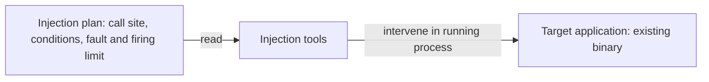
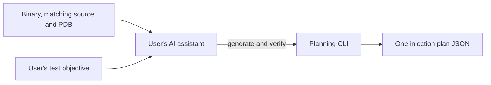

# Fault injection design

## Execution

## Planning

The user describes the behavior to test. The AI assistant in the user's environment inspects the binary, matching source and PDB, and uses the planning CLI to identify the call site and verify one JSON plan.

The planning tool is `dotnet-fault-injection`. Windows execution uses `tools/Invoke-FaultInjection.ps1`, which configures the child process and loads the profiler engine and extension. Users provide the plan rather than starting engine components individually.

## Files and responsibilities

| File | Responsibility | Stage |
| --- | --- | --- |
| Target EXE/DLL | Existing binary to identify and instrument | Planning and execution |
| Matching source | Select the source call | Planning |
| Matching PDB | Bind source location to binary instructions | Planning |
| plan.json | Target identity, call site, conditions, fault and budget | Generated/verified, then executed |
| MicrosoftInstrumentationEngine_x64.dll | Windows profiler engine | Target startup |
| Rewrite.xml | Select the extension DLL | Engine initialization |
| Rewrite.dll | Read the plan and rewrite selected in-process calls | Execution |

Use the same verified plan.json as execution input. There is no separate definition JSON to convert into a plan. Source/project/build inputs belong to planning context rather than execution-plan fields. Engine, extension and configuration form a deployment unit; per-test sites and conditions belong in the plan.

## Design and implementation boundaries

This document describes roles and relationships. The dedicated CoreFileTarget PoC contains a fault helper in the target DLL. Folder organization alone does not turn that fixture into helper-free injection. Generic helper-free plan injection has separately been verified on Linux x64 / .NET 8.

See [samples](samples/README.md) and the [AI planning guide](src/Tool/AI-plan-guide.md).
