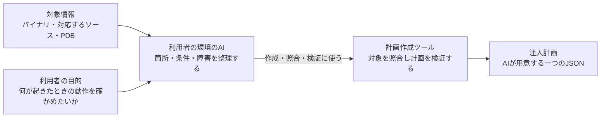

# 障害注入の設計

## 1. 実行時

## 2. 注入計画の作成時

利用者が確かめたいことを伝え、利用者の環境で使うAIが注入計画を作ります。
AIは、対象箇所の照合と計画の検証に計画作成ツールを使います。

## 3. ツールの定義

| 図の中の役割 | 対応するツール | 責任 | 使う段階 |
|---|---|---|---|
| 計画作成ツール | dotnet-fault-injection.exe | 利用者の環境のAIが使い、対象情報の照合、計画の生成・検証を行う | 計画作成時 |
| 注入ツール | tools/Invoke-FaultInjection.ps1 を入口とする実行機能 | 計画を渡して対象を起動し、プロファイラーを読み込ませて注入する | 実行時 |

注入ツールは、エンジン・拡張の読み込みと環境変数の設定をまとめて担当します。
利用者がエンジンや拡張を個別に起動する構成にはしません。

## 4. ファイルの定義

### 対象と注入計画

| ファイル | 内容 | 使う段階 |
|---|---|---|
| 対象のEXE・DLL | 注入される既存バイナリ | 計画作成時に照合し、実行時に注入対象とする |
| 対象に対応するソース | 注入箇所を選ぶための資料 | 計画作成時 |
| 対象に対応するPDB | ソースの位置とバイナリ内の位置を照合するための資料 | 計画作成時 |
| plan.json | 対象の照合情報、注入箇所、発火条件、障害、発火上限を記述する唯一の計画 | 計画作成時に出力し、実行時に読み込む |

計画作成の出力と実行時の入力には、同じplan.jsonを使います。
別の定義JSONや、定義を計画に変換する段階は設けません。

### 注入ツールの内部ファイル

| ファイル | 内容 | いつ使われるか |
|---|---|---|
| MicrosoftInstrumentationEngine_x64.dll | .NETに読み込ませるプロファイラー本体 | 対象プロセスの起動時 |
| Rewrite.xml | エンジンが読み込む拡張DLLを指定する設定 | エンジンが拡張を読み込むとき |
| Rewrite.dll | plan.jsonを読み、対象プロセス内の呼び出し命令を書き換える拡張 | 対象プロセスの実行中 |

これらは一組の実行用部品として注入ツール側にまとめます。
試験ごとの注入箇所や発火条件は、plan.jsonで指定します。

## 5. 設計と現在の実装の差

この文書は、要素と関係を整理した設計です。
現在のCoreFileTargetは、障害を起こす専用ヘルパーを対象DLLに組み込んだPoCです。
既存バイナリに専用ヘルパーを追加せず注入する設計を成立させるには、注入ツール側で
障害処理を提供する必要があります。この差は、フォルダや説明を整理しただけでは解消しません。

サンプルの対象と計画は [サンプル一覧](samples/README.md) にまとめています。
