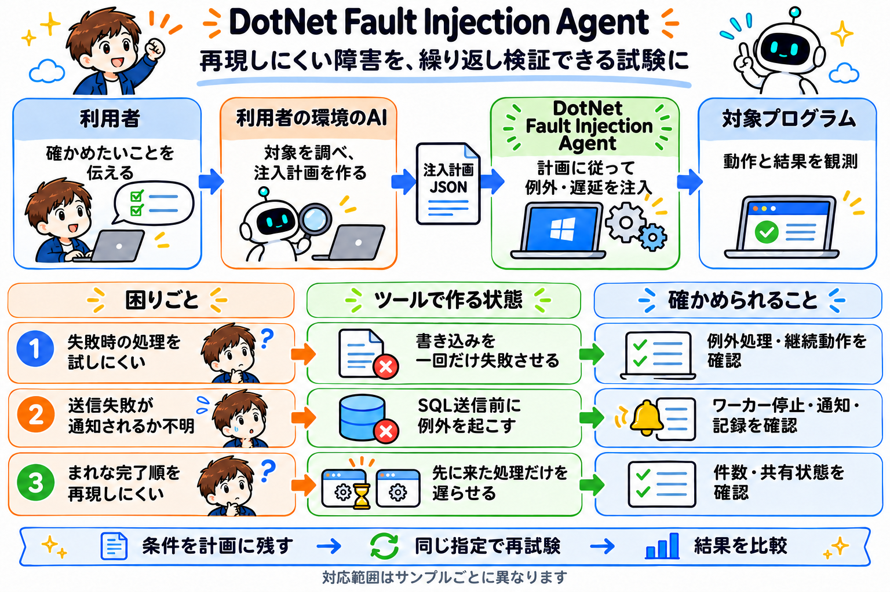

# DotNet Fault Injection Agent

DotNet Fault Injection Agentは、.NETアプリケーションで再現しにくい失敗や処理の遅れを意図的に起こし、障害時の動作を繰り返し検証するためのツールです。

正常に動くことは確認できても、ファイルに書き込めなかったとき、SQLを送信できなかったとき、処理の完了順が逆になったときの動作まで確かめるには、その状態を作る必要があります。
実際の障害を待つだけでは、試したい箇所で、試したい条件の失敗が起きるとは限りません。

このツールでは、対象プログラムを動かしながら、指定したAPI呼び出しの直前に例外や遅延を差し込みます。
「どこで、どの条件で、何を、何回まで起こすか」を一つの注入計画に残すことで、同じ指定で検証を繰り返せます。
その結果から、例外処理、エラー通知、再試行、データ更新が期待どおりに動くかを確認します。

## どんな検証に使えるか

### 正常時には通らないエラー処理を確かめる

いつも成功するファイル書き込みを、最初の一回だけ失敗させます。
書き込み直前にIOExceptionが起きたとき、アプリが例外を捕捉するか、失敗を記録するか、次の処理へ進めるかを確認できます。

ファイル書き込みのサンプルでは一回目の失敗への対処と、二回目の正常な書き込みを、一つの実行で観測します。

### 送信失敗に対する復旧と通知を確かめる

選んだSQL呼び出しの送信前にTimeoutExceptionを起こす試験ができます。
ワーカーが停止するか、エラーが画面やログへ伝わるか、再試行するプログラムなら処理を再開できるかを確認します。

例外が発生したことと、アプリが正しく対処できたことは分けて観測します。
DBへの書き込みやアプリの状態も照合し、送信前の失敗と、DBの処理後に応答を失う状況を区別します。

### 普段は起きにくい完了順を作って確かめる

先に始まった処理だけを遅らせ、後から始まった処理を先に完了させます。
この状態で、件数や共有状態が正しく更新されるかを確認します。

注文投入のサンプルでは先に完了した処理と、遅れて完了した処理のそれぞれについて、アプリの件数とDBの件数を比べます。

## 利用者の環境のAIが注入計画を作る

利用者は、自分の環境で使っているAIに、対象プログラムと確かめたいことを伝えます。
たとえば「注文投入が一回失敗したとき、画面にエラーが伝わるかを確かめたい」と依頼します。

そのAIが対象の処理を調べ、注入する箇所、発火条件、障害、回数を整理します。
計画作成ツールで対象バイナリとソース・PDBを照合し、実行指示を一つの注入計画JSONとして作成・検証します。
利用者は、どの処理に何を起こす計画かを確認し、そのファイルを使って検証します。

役割は、利用者が検証の目的を伝え、利用者の環境のAIが計画を作り、注入ツールがその計画を実行する、という分担です。

## 対象・計画・ツールの関係

対象プログラムは検証したいアプリケーションのEXEやDLLです。
注入計画は箇所、発火条件、障害、発火上限を記述する一つのJSONです。
注入ツールが計画を読み、対象プロセス内の呼び出しに介入します。配布されたEXEやDLLのファイル自体は書き換えません。

準備の段階では、利用者の環境のAIが計画作成ツールを使い、対象バイナリと対応するソース・PDBを照合して注入箇所を特定します。
実行の段階ではその計画を注入ツールへ渡して対象を動かします。
利用者がデバッガで実行を止め、その都度障害を作る操作は必要ありません。

実行時の介入には、.NETのプロファイラー機能を利用しています。
内部のファイルや読み込み方式は、[全体設計](CORE_FILE_INJECTION.md)で説明しています。

## サンプルから試す

[サンプル一覧](samples/README.md)では、対象プログラム、この計画で行う注入、期待する結果を説明しています。
具体的な操作は [準備・実行の手順](samples/OPERATIONS.md) に分けています。

現在は機構を検証するPoCで、主な注入は呼び出し直前の例外と遅延です。
戻り値の書換えは固定メソッドの検証例があり、任意のAPIの戻り値を自由に指定する機能は未対応です。
Windowsの専用試験には、対象側に障害処理のヘルパーを組み込んだものもあります。
対象にヘルパーへの参照を追加しない方式は、Linux x64 / .NET 8の汎用計画PoCで検証しています。

対応する呼び出しや環境は、各サンプルのREADMEにあります。
開発用のソースと詳細な検証手順は [開発用の実装](src/README.md)、説明方針の根拠は [類似ツールの調査](docs/research/tool-positioning.md) にまとめています。

内部の識別子・成果物名を変更する際の影響は、[内部名と互換性](docs/development/naming-compatibility.md)にまとめています。

## 開発と配布

実装は `src/`、検証コードは `tests/`、計画スキーマは `schemas/`、操作スクリプトは `tools/` にあります。
NuGet公開対象は計画作成CLIです。[パッケージの作成・検証と公開前の確認事項](docs/packaging/README.md)を参照してください。
