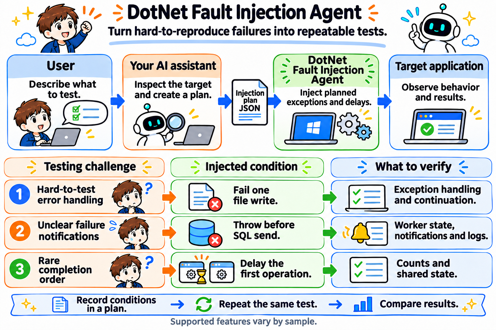

# DotNet Fault Injection Agent

Turn hard-to-reproduce failures in .NET applications into repeatable tests.



Describe the behavior you want to test to the AI assistant in your environment. It inspects the target binary and matching source/Portable PDB, identifies a call site, and creates a verified JSON injection plan. The injection tools execute that plan; the user checks application behavior, logs and external state.

## What you can test

- Fail one file write to check exception handling and continuation.
- Throw before a SQL send to check error propagation, notification and retry behavior.
- Delay an earlier operation to observe a different completion order and compare application and database counts.

The target is the application EXE or DLL. A plan specifies the call site, conditions, fault and firing limit. The profiler intervenes in the running process; it does not rewrite the deployed binary on disk. Source and PDB are planning inputs, not fields to bundle into an execution plan.

## Planning CLI

The NuGet package is `DotNetFaultInjectionAgent.Tool`, with command `dotnet-fault-injection`. It requires .NET 10. The package contains the planning CLI and managed dependencies; the native profiler and injection runtime are deployed separately.

```text
dotnet-fault-injection capabilities
dotnet-fault-injection dotnet plan target.dll Program.cs 22 plan.json
dotnet-fault-injection dotnet verify target.dll Program.cs 22 plan.json
```

See [package preparation](docs/packaging/README.md) for local builds and installation. NuGet.org publication is a separate release step.

## Supported scope

This is a proof of concept. Generic version 3 injection is tested on Linux x64 / .NET 8 and supports synchronous exceptions and delays before selected external calls. Conditions include environment equality, invocation start and firing limits. Argument matching, ReJIT, faulted Task injection and arbitrary return-value replacement are not supported. Windows version 1/2 samples use dedicated fixtures, some with built-in fault helpers. A fixed-method return-value rewrite is available as a separate demonstration.

## Repository

Implementation is in `src/`, fixtures and verification in `tests/`, plan schemas in `schemas/`, user examples in `samples/`, and scripts in `tools/`. Generated files go under `artifacts/`.

- [Implementation](src/README.md)
- [Samples](samples/README.md)
- [Sample preparation and execution](samples/OPERATIONS.md)
- [Naming and migration](docs/development/naming-compatibility.md)
- [NuGet release preparation](docs/packaging/README.md)

## License

The project is licensed under the [MIT License](LICENSE). Dependencies retain their own licenses.

## Ask an AI assistant to create a plan

Tell the AI assistant in your environment which application behavior you want to test and provide the deployed binary, matching source/Portable PDB and execution environment. The assistant uses the CLI to identify and verify a call site, selects supported conditions and faults, and returns one verified JSON plan with the expected observations.

Use the [AI planning guide and copyable request](src/Tool/AI-plan-guide.md). Plan verification and successful fault injection are separate results.

## Start with the guide

Ask your AI assistant to run `dotnet-fault-injection guide` and read the output before creating a plan. The guide explains the tool, supported workflow, required inputs and verification boundaries. It is embedded in the installed CLI and works offline.

With a repository checkout, the assistant can instead read `src/Tool/AI-plan-guide.md`. The CLI embeds that same file at build time.

```text
First run dotnet-fault-injection guide and read its output.
Alternatively, read src/Tool/AI-plan-guide.md in this repository checkout.
Follow the guide to create and verify a plan for the target and test objective I provide.
If the guide is unavailable, report that before proceeding.
```


## Choose by target runtime and operating system

The CLI itself requires .NET 10. That requirement is separate from the runtime of the application being tested.

Run `dotnet-fault-injection capabilities` to see the supported target combinations. Choose the target runtime and OS, not a JSON-format generation.

| Application | Support and planning command | Startup and deployment |
| --- | --- | --- |
| .NET Framework 4.8 / Windows x64 | Dedicated fixtures and order host: `windows-fixture list/plan/verify` | Launch the EXE with COR_* profiler settings and the Windows engine/extension/XML. Some fixtures contain built-in fault helpers. |
| .NET 10 / Windows x64 | Dedicated CoreFileTarget only: `windows-fixture list/plan/verify` | Launch the apphost EXE with CORECLR_* settings; bind the plan to its managed DLL, not the apphost. This does not establish generic Windows .NET support. |
| .NET 8 / Linux x64 | Generic external-call injection: `dotnet list/plan/verify` | Launch `dotnet target.dll` with CORECLR_* settings, Linux engine/extension/XML, the managed injection Runtime beside the application, and DOTNET_ADDITIONAL_DEPS pointing to its deps.json. |

On Windows, the sample launcher detects the adjacent runtimeconfig.json to select COR_* or CORECLR_* settings. The Windows launcher accepts dedicated fixture plans; it cannot execute the generic Linux plan simply by changing a prefix. Windows services require service-specific startup configuration rather than a normal process launch.

For generic .NET/Linux planning:

```text
dotnet-fault-injection capabilities
dotnet-fault-injection dotnet list target.dll Program.cs 22
dotnet-fault-injection dotnet plan target.dll Program.cs 22 plan.json
dotnet-fault-injection dotnet verify target.dll Program.cs 22 plan.json
```

For dedicated Windows fixtures, supply source/project, the actual managed binary and the matching reference-assembly directory:

```text
dotnet-fault-injection windows-fixture list <source|project> <binary> <references>
dotnet-fault-injection windows-fixture plan <source|project> <binary> <references> <selection> <plan.json>
dotnet-fault-injection windows-fixture verify <source|project> <binary> <references> <plan.json>
```

Plan-format numbers are internal compatibility details. Existing `v3` and unprefixed fixture commands remain available for existing scripts. Neither route makes unsupported runtime/OS combinations supported.
